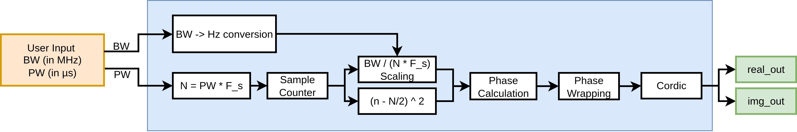
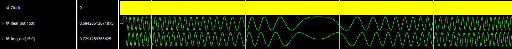
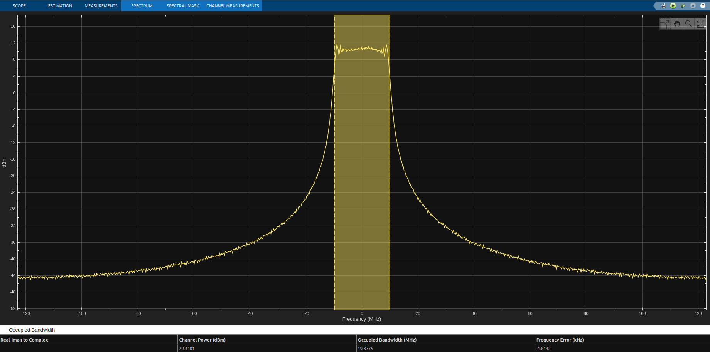
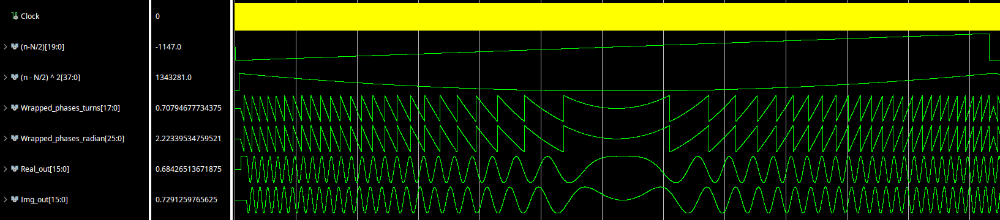
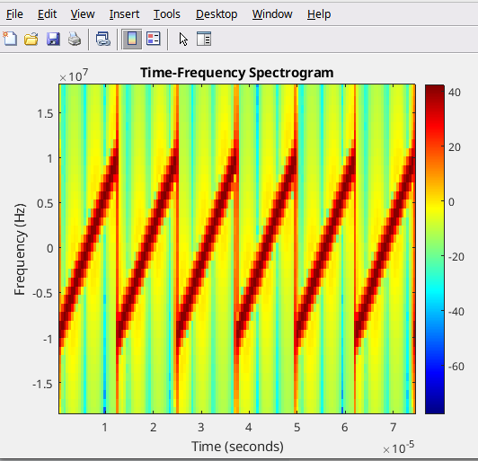

# Chirp Waveform Generator Using Vitis Model Composer for FPGA

A parameterized FPGA-oriented chirp generator developed using AMD Vitis Model Composer. The design generates a complex baseband I/Q waveform from user-defined bandwidth (BW) and pulse width (PW), using quadratic phase generation, phase wrapping, and CORDIC-based phase-to-I/Q conversion.

[](https://www.hackster.io/mehtisham/chirp-waveform-generator-using-vitis-model-composer-for-fpga-098aae)

## Overview

Chirp signals are widely used in radar, communications, sensing, software-defined radio, and digital signal processing. A linear frequency-modulated (LFM) chirp changes its instantaneous frequency linearly with time.

The objective of this project is to develop a reusable FPGA-oriented architecture in which the user specifies:

* **Bandwidth (BW)**
* **Pulse width (PW)**

The design calculates the required sample count and phase trajectory internally, then generates the corresponding complex I/Q samples.

The implementation was developed and evaluated using AMD Vitis Model Composer, with MATLAB used for signal analysis. The current project focuses on model-based development and simulation; physical FPGA hardware validation is planned as future work.

## Project Features

* Parameterized chirp generation using BW and PW
* Centered complex-baseband chirp from approximately \(-BW/2\) to \(+BW/2\)
* Discrete-time quadratic phase generation
* Fixed-point, FPGA-oriented processing
* Phase normalization and wrapping
* CORDIC-based I/Q generation
* I/Q waveform and complex-spectrum inspection
* MATLAB-based instantaneous-frequency analysis

## System Architecture

The main processing stages are:

1. Bandwidth input and scaling
2. Pulse-width-to-sample-count conversion
3. Sample counter
4. Centered sample-index calculation
5. Quadratic phase calculation
6. Phase normalization and wrapping
7. Conversion of the wrapped phase to radians
8. CORDIC phase-to-I/Q conversion
9. Output timing alignment

The design uses the same overall clock for the main processing stages in the current model. The CORDIC configuration introduces pipeline latency, which must be considered when aligning valid signals and corresponding I/Q samples.



## Mathematical Background

### Linear Frequency-Modulated Chirp

For an LFM chirp, the instantaneous frequency changes linearly with time. For a centered complex-baseband chirp, the intended frequency sweep is:

$$
f(t)=-\frac{BW}{2}+\frac{BW}{PW}t
$$

where:

* \(BW\) is the chirp bandwidth
* \(PW\) is the requested pulse width
* \(t\) is time within the pulse

The phase is obtained by integrating the instantaneous frequency. The resulting phase trajectory is quadratic, which allows the frequency sweep to be generated from a phase function.

$$\phi_{\text{baseband}}(t) = \pi \frac{\text{BW}}{\text{PW}} \left(t - \frac{\text{PW}}{2}\right)^2$$

### Discrete-Time Implementation

The number of samples corresponding to the requested pulse width is:

$$
N_{\mathrm{ideal}}=PW \times f_s
$$

where \(f_s\) is the sampling frequency.

Since the sample count must be an integer, the implementation uses an integer value of \(N\). For this project, the centered phase trajectory is based on the sample index \(n\), with the pulse center represented by \(N/2\).

The normalized phase is wrapped before being converted to radians for the CORDIC input. This keeps the phase presented to the phase-to-I/Q conversion stage within the selected range.

The current implementation uses the centered formulation. The alternative \(0\) to \(BW\) formulation is discussed in the accompanying article but is not a separate selectable mode in the current model.

## Simulation Configuration

The example configuration used for the results is:

| Parameter                   |              Value |
| --------------------------- | -----------------: |
| Sampling frequency          |         245.76 MHz |
| Bandwidth                   |             20 MHz |
| Requested pulse width       |              10 µs |
| Ideal sample count          |             2457.6 |
| Implemented sample count    |               2458 |
| Approximate frequency sweep | −10 MHz to +10 MHz |

For 2458 sample periods at 245.76 MHz, the represented duration is approximately 10.00163 µs. This small difference comes from rounding the ideal sample count to an integer.

## I/Q Generation

The wrapped phase, converted to radians, is supplied to a CORDIC block to generate the in-phase and quadrature components:

$$
I[n]=\cos(\phi[n])
$$

$$
Q[n]=\sin(\phi[n])
$$

The complex output is:

$$
x[n]=I[n]+jQ[n]
$$

For the centered 20 MHz chirp, the instantaneous frequency begins near −10 MHz, approaches 0 Hz near the middle of the pulse, and increases toward +10 MHz near the end. Accordingly, the I/Q oscillations are faster near the beginning and end, and slower around the middle.

## Simulation Results

### I and Q Waveforms

The I and Q signals are inspected to verify the phase-to-I/Q conversion and the expected change in oscillation rate over the pulse.



### Complex I/Q Spectrum

The complex spectrum is inspected to verify the approximate occupied bandwidth and the centered baseband frequency sweep.



### Phase Verification

The internal phase-generation stages are inspected, including the quadratic phase calculation, normalized phase wrapping, and conversion to radians.



### Instantaneous Frequency Versus Time

The generated samples are exported for analysis in MATLAB. The instantaneous-frequency plot is used to verify the approximately linear frequency sweep expected from an LFM chirp.



## Tools Used

* AMD Vitis Model Composer
* MATLAB and Simulink
* AMD FPGA-oriented fixed-point design blocks

Use the appropriate compatible versions and required licenses for your local installation.

## Repository Structure

```text
FPGA-Chirp-Generator-using-Vitis-Model-Composer/
├── README.md
├── figures/
│   ├── chirp_generator_architecture.png
│   ├── iq_waveforms.png
│   ├── complex_iq_spectrum.png
│   ├── phase_verification.png
│   └── instantaneous_frequency_vs_time.png
├── model_composer/
│   ├── README.md
│   └── chirp_waveform_generator.slx
└── matlab/
    ├── README.md
    └── chirp_analysis.m
```

The tree above describes the intended organization. Files that are not included in the published repository should not be assumed to be available.

## How to Use This Repository

1. Review the architecture and mathematical background in this README.
2. Open the Model Composer model included in `model_composer/`.
3. Check the model's required blocks, parameters, fixed-point settings, and software dependencies.
4. Run the simulation with the configuration described above, or change BW and PW within the supported model limits.
5. Export the data to MATLAB, and run the script to reproduce the frequency-versus-time analysis.
6. Compare the resulting I/Q waveforms, spectrum, and frequency trajectory with the figures in `figures/`.

The exact steps required to run the model may depend on the Model Composer version and any external dependencies.

## Current Status and Future Work

The current project demonstrates the chirp-waveform-generation architecture through Model Composer development and simulation-based analysis.

Planned future work includes:

* Packaging the design as reusable FPGA IP
* Integrating the IP into a Vivado design
* Targeting the AMD ZCU102 platform
* Interfacing the waveform generator with the ADRV9009
* Updating BW and PW through a system interface
* Capturing and measuring the generated waveform on hardware

These hardware tasks are planned work and are not claimed as completed results in this repository.

## Related Project

**Hackster.io article:** [Chirp Waveform Generator Using Vitis Model Composer for FPGA](https://www.hackster.io/mehtisham/fpga-chirp-generator-using-vitis-model-composer-098aae)

For another FPGA signal-generation project, see:

[Generating Gaussian Noise in FPGA Using LFSRs and CLT](https://www.hackster.io/mehtisham/generating-gaussian-noise-in-fpga-using-lfsrs-and-clt-406607)

## Author

**Muhammad Ehtisham**

This repository documents an FPGA-oriented signal-processing project developed using AMD Vitis Model Composer and MATLAB.

## Disclaimer

This project is provided for learning, development, and research purposes. The published results correspond to the simulation and analysis resources actually included in the repository. Hardware performance should be independently verified on the intended FPGA platform.
